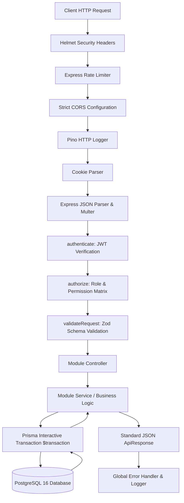
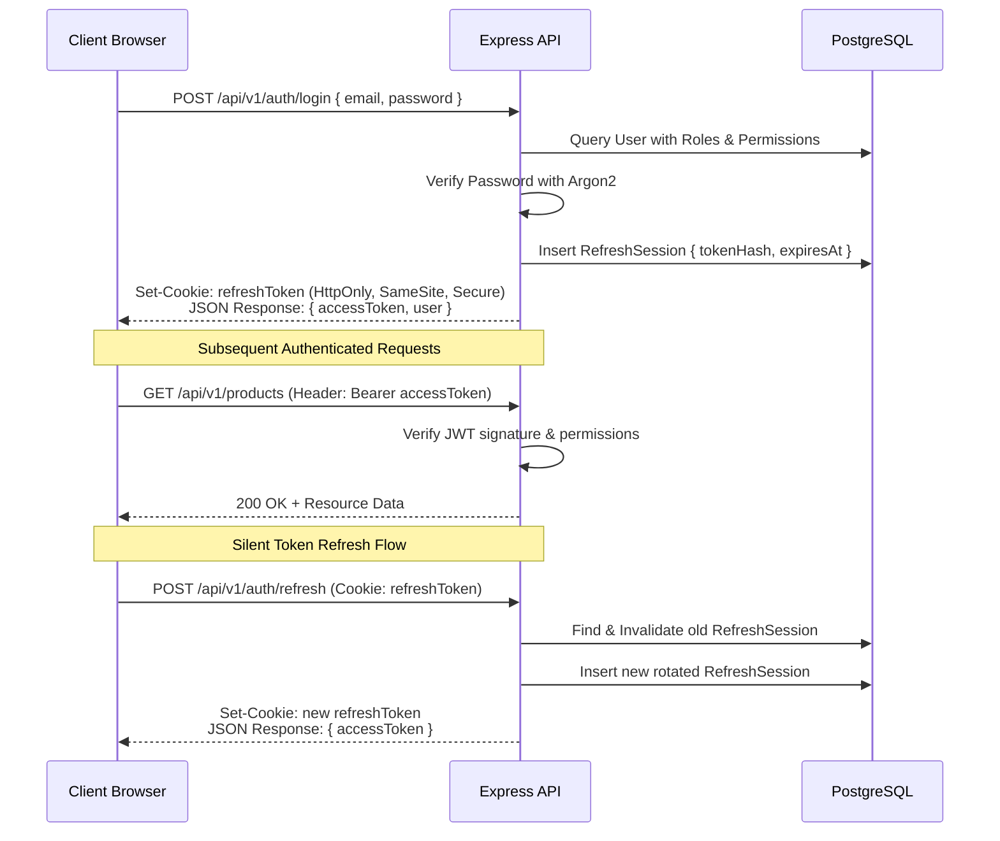

# StockFlow — System Architecture & Technical Specification

## 1. System Overview

**StockFlow** is an enterprise-grade, full-stack Inventory Management System engineered to provide end-to-end visibility, precision stock tracking, automated procurement, sales fulfillment, multi-warehouse logistics, and real-time business intelligence.

The system is architected around the principle of **strict transaction integrity and ledger immutability**: stock balances are never arbitrary numbers overwritten by clients, but the deterministic, concurrency-safe result of verified business transactions logged into an immutable stock movement ledger.

---

## 2. Monorepo Structure

```
stockflow-inventory-management/
├── client/                     # Modern React 18 + Vite + Tailwind SaaS Frontend
│   ├── public/                 # Static assets
│   └── src/
│       ├── app/                # Application root providers & React Router v6
│       ├── assets/             # Branding and icons
│       ├── components/         # UI primitives, layout, data tables, modals
│       │   ├── ui/             # shadcn-inspired primitives (Button, Input, Card, etc.)
│       │   ├── common/         # Data tables, Status badges, Skeletons, Modals
│       │   └── layout/         # AppLayout, Sidebar, Navbar, PageHeader
│       ├── features/           # Domain feature modules (Auth, Dashboard, Inventory, etc.)
│       ├── hooks/              # Reusable React hooks
│       ├── lib/                # Axios instance, queryClient, utils
│       ├── services/           # Typed API service wrappers
│       ├── types/              # Domain & DTO TypeScript interfaces
│       └── utils/              # Formatters, currency, math helpers
├── server/                     # Node.js + Express + Prisma + PostgreSQL Backend
│   ├── prisma/
│   │   ├── schema.prisma       # Normalized relational schema (30+ entities)
│   │   ├── migrations/         # Prisma migration history
│   │   └── seed.ts             # Comprehensive demo data seed script
│   └── src/
│       ├── config/             # Environment, DB, logger configuration
│       ├── middleware/         # Auth, RBAC, error, validation, logging middleware
│       ├── modules/            # Feature vertical slices (Controller, Service, Router, Schema)
│       │   ├── auth/           # Login, logout, refresh, password reset
│       │   ├── users/          # User management & profile
│       │   ├── dashboard/      # Aggregated metrics & trends
│       │   ├── products/       # Products, variants, images, CSV import/export
│       │   ├── categories/     # Category hierarchy
│       │   ├── brands/         # Brand catalogue
│       │   ├── warehouses/     # Multi-warehouse stock & transfers
│       │   ├── inventory/      # Stock balances, adjustments, movements
│       │   ├── purchases/      # Purchase orders, goods receipt, returns
│       │   ├── sales/          # Sales orders, fulfillment, invoices, payments, returns
│       │   ├── suppliers/      # Supplier relationships & metrics
│       │   ├── customers/      # Customer relationships & balances
│       │   ├── reports/        # Valuation, P&L, stock turnover, sales analytics
│       │   ├── notifications/  # Low-stock alerts, approval queues
│       │   ├── audit/          # Security & business event logs
│       │   └── settings/       # Company profile, tax, prefixes, policies
│       ├── shared/             # Base AppError, ApiResponse, pagination helpers
│       ├── types/              # Server-side TypeScript interfaces
│       ├── app.ts              # Express application factory & middleware chain
│       └── server.ts           # HTTP server listener & graceful shutdown
├── docs/                       # Architecture, DB schema, API specs, Setup guides
├── docker-compose.yml          # Isolated PostgreSQL 16 container definition
└── package.json                # Root npm workspaces orchestrator
```

---

## 3. Backend Architecture & Request Lifecycle

Each incoming HTTP request travels through a predictable, highly secured pipeline:



### Concurrency Protection & Transaction Boundaries
All stock movements, purchase order receipts, and sales fulfillment events execute within `prisma.$transaction`. Stock balances are checked and updated atomically:
- Row-level locking ensures that concurrent orders cannot oversell remaining inventory.
- Before committing any negative delta, the service verifies `currentStock >= requestedQuantity` (unless `negativeStockPolicy` is explicitly set to allowed).
- An immutable `StockMovement` ledger entry is written in the identical transaction that increments/decrements `StockBalance`.

---

## 4. Authentication, Session & Authorization Flow



### Roles and Permissions Matrix
1. **SUPER_ADMIN**: Absolute system control, tenant settings, user roles, audit inspection.
2. **ADMIN**: Full operational management (inventory, sales, purchases, warehouses, users).
3. **MANAGER**: Operational authority over inventory adjustments, purchase approvals, sales fulfillment, and financial reports.
4. **STAFF**: Daily order entry, goods receiving, stock transfers, customer & supplier lookups.
5. **VIEWER**: Strict read-only access to products, stock levels, and non-sensitive dashboards.

---

## 5. Inventory Valuation & Costing

StockFlow implements **Weighted Average Costing (WAC)**:
$$\text{New Average Cost} = \frac{(\text{Current Qty} \times \text{Current Unit Cost}) + (\text{Received Qty} \times \text{Purchase Unit Cost})}{\text{Current Qty} + \text{Received Qty}}$$

Whenever a `GoodsReceipt` is confirmed:
1. The inventory cost price is recalculated based on the incoming purchase cost.
2. The ledger records the cost basis at that precise moment.
3. Historical reporting uses recorded historical transaction costs, guaranteeing deterministic financial reporting.

---

## 6. Frontend Architecture & Design Philosophy

- **Component Primitives**: Custom design tokens mirroring shadcn/ui built on Tailwind CSS.
- **State Separation**:
  - Server state: TanStack Query (React Query v5) with standardized caching keys (`['products', filters]`, `['inventory', warehouseId]`).
  - Local UI state: React state & React Hook Form.
  - Global client state: Zustand stores for user session, active theme, and sidebar drawer state.
- **Micro-Interactions**: Smooth CSS transitions, skeleton loaders during network latency, toast notifications via Sonner, and confirmation dialogs before irreversible financial/stock actions.
- **Accessibility & Contrast**: Built according to WCAG 2.1 AA standards with distinct light and dark theme palettes.
