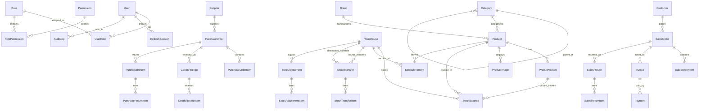

# StockFlow — PostgreSQL Database Schema Specification

## 1. Relational Database Design Principles

StockFlow's database architecture is built upon PostgreSQL 16 using Prisma ORM. It adheres to strict third normal form (3NF), enforces referential integrity with explicit foreign keys and cascade rules, uses UUID primary keys for collision-free distributed generation, and utilizes `Decimal(12, 4)` and `Decimal(12, 2)` for precision quantities and monetary amounts, strictly avoiding IEEE-754 floating-point inaccuracies.

---

## 2. Entity Relationship Overview

---

## 3. Data Dictionary & Key Entities

### Security & Access Control
- `User`: Core user account (`id`, `email`, `passwordHash`, `firstName`, `lastName`, `phone`, `avatarUrl`, `isActive`, `lastLoginAt`, timestamps).
- `Role`: Security roles (`id`, `name`, `code`, `description`, `isSystem`).
- `Permission`: Granular permissions (`id`, `code`, `name`, `module`, `action`).
- `UserRole`: Join table mapping users to roles.
- `RolePermission`: Join table mapping roles to authorized permissions.
- `RefreshSession`: Secure session tracking for rotated refresh tokens (`id`, `userId`, `tokenHash`, `userAgent`, `ipAddress`, `isRevoked`, `expiresAt`, timestamps).
- `PasswordResetToken`: Secure hashed password reset tokens with strict expiry.

### Product Catalog
- `Category`: Hierarchical product taxonomy with optional `parentId` self-relation.
- `Brand`: Product manufacturers and brand identifiers.
- `Product`: Core product record (`sku`, `barcode`, `name`, `slug`, `description`, `unit`, `costPrice`, `sellingPrice`, `taxRate`, `reorderLevel`, `status`, `isArchived`).
- `ProductVariant`: SKU variants (`variantSku`, `variantName`, `costPrice`, `sellingPrice`, `attributesJson`).
- `ProductImage`: Media attachments with primary flag, sort order, and CDN/local path.

### Multi-Warehouse & Stock Ledger
- `Warehouse`: Storage facilities (`code`, `name`, `address`, `contactName`, `phone`, `email`, `isDefault`, `isActive`).
- `StockBalance`: Real-time warehouse balance cache (`warehouseId`, `productId`, `productVariantId`, `quantityOnHand`, `allocatedQuantity`, `availableQuantity`). Unique index on `[warehouseId, productId, productVariantId]`.
- `StockMovement`: Immutable transactional ledger (`warehouseId`, `productId`, `productVariantId`, `type`, `quantity`, `unitCost`, `balanceAfter`, `referenceType`, `referenceId`, `reason`, `userId`, `createdAt`).
- `StockTransfer`: Warehouse-to-warehouse stock movements (`transferNumber`, `sourceWarehouseId`, `destinationWarehouseId`, `status`, `dispatchedAt`, `receivedAt`).
- `StockAdjustment`: Physical inventory reconciliation (`adjustmentNumber`, `warehouseId`, `type`, `status`, `reason`, `notes`, `approvedBy`).

### Procurement Lifecycle
- `Supplier`: Vendor profiles (`code`, `companyName`, `contactPerson`, `email`, `phone`, `taxId`, `paymentTerms`, `isActive`).
- `PurchaseOrder`: Purchase orders (`orderNumber`, `supplierId`, `warehouseId`, `status`, `subtotal`, `taxAmount`, `discountAmount`, `grandTotal`, `orderedAt`, `expectedAt`).
- `GoodsReceipt`: Physical inventory intake (`receiptNumber`, `purchaseOrderId`, `warehouseId`, `receivedDate`, `receivedBy`). Increases stock atomically.
- `PurchaseReturn`: Vendor returns (`returnNumber`, `purchaseOrderId`, `supplierId`, `reason`, `status`).

### Sales & Order Fulfillment
- `Customer`: Customer records (`code`, `name`, `email`, `phone`, `company`, `billingAddress`, `shippingAddress`, `creditLimit`, `isActive`).
- `SalesOrder`: Customer sales orders (`orderNumber`, `customerId`, `warehouseId`, `status`, `subtotal`, `taxAmount`, `discountAmount`, `grandTotal`).
- `Invoice`: Financial billing documents linked to sales orders.
- `Payment`: Recorded cash, card, or transfer transactions (`invoiceId`, `customerId`, `amount`, `paymentMethod`, `referenceNumber`, `status`).
- `SalesReturn`: Customer returns (`returnNumber`, `salesOrderId`, `status`, `reason`, `refundAmount`).

### Analytics & System Auditing
- `BusinessSettings`: Organization name, address, currency symbol, tax defaults, PO/SO prefix conventions, negative stock policy.
- `AuditLog`: Immutable audit trail of actor actions (`userId`, `action`, `entityType`, `entityId`, `oldValues`, `newValues`, `ipAddress`).
- `Notification`: In-app system alerts (`type`, `title`, `message`, `isRead`, `linkUrl`, `createdAt`).
